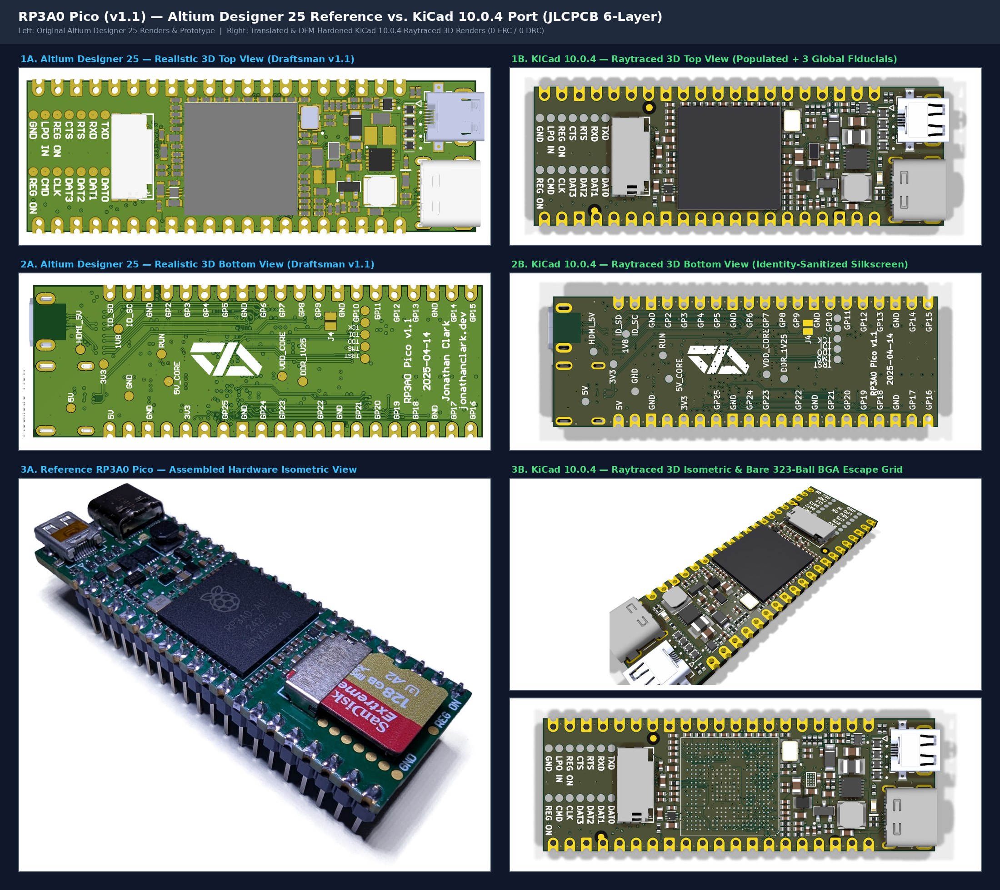

# RP3A0 Pico, ported to KiCad

A KiCad 10 port of **[jonny12375](https://github.com/jonny12375)'s [RP3A0 Pico](https://github.com/jonny12375/rp3a0)**: the Raspberry Pi Zero 2W's RP3A0 chip (quad-core Cortex-A53 + 512 MB RAM) on a board the size of a Raspberry Pi Pico, with Micro-HDMI, USB-C and microSD.

> **The design is jonny12375's work.** They reverse-engineered the RP3A0 pinout, harvested and reballed the chip from a Zero 2W, designed the board in Altium, and built one that boots and gets online. Please go read and star [the original repo](https://github.com/jonny12375/rp3a0). The [reballing guide](https://github.com/jonny12375/rp3a0/blob/main/docs/reballing.md) is there too, and you'll need it to build one of these.




## Why this port exists

The original is an Altium project, and plenty of people don't have Altium or can't open its files. This repo puts the same design in KiCad, which is free, and adds JLCPCB-ready output so you can order it without redoing the work.

## Status

- **The original design works.** jonny12375 built it and it boots and gets online (their notes: HDMI is sketchy, there is no Wi-Fi, and USB-C is a bit odd).
- **This KiCad port has not been fabricated yet.** We tried to recreate the original faithfully and it passes ERC/DRC, but a clean DRC doesn't mean the board boots. If you build one, please [open an issue](../../issues) and tell us how it went, good or bad.

## What changed from the original

The goal was a faithful copy, but a few things were fixed along the way:

- **Crystal load caps:** `C6`/`C9` were resized from 18 pF to 30 pF (0402 C0G, LCSC `C1570`) to correctly match the 19.2 MHz crystal's 18 pF load specification ($C_L = \frac{30 \times 30}{30 + 30} + C_{\text{stray}} \approx 15.0\text{ pF} + 3.0\text{ pF} = 18.0\text{ pF}$, fixing the upstream 18 pF caps which only yielded 11.5 pF effective load).
- **Ground and power:** added a GND pour on `In4.Cu` with extra stitching vias, and widened a thin 0.15 mm section of the 5V input to 0.50 mm.
- **Manufacturability:** solder mask webs on the fine-pitch parts (`U3`, `J2`), fiducials and teardrops.
- **Parts:** a few discontinued or out-of-stock parts swapped for equivalents JLCPCB stocks.
- **Fab outputs:** Gerbers, BOM and pick-and-place files ready to upload to JLCPCB, with rotations corrected.

The full before/after table and the check results are in [docs/VALIDATION.md](docs/VALIDATION.md).

## System Architecture

```text
+-----------------------------------------------------------------------------------+
|                                 RP3A0 PICO (6-LAYER)                              |
|                                                                                   |
|  [J3: USB-C 5V/OTG] ---> [Q1: DMG2305UX] ---> 5V_CORE ---> [U3: RT8088AWSC]       |
|         |                                       (I2C)           |                 |
|         +--------------> [U4: PAM2306AYPKE]                     v                 |
|         |                  |            |                  VDD_CORE (0.6-1.35V)   |
|         |                  v            v                       |                 |
|         |             3V3 (1A)      1V8 (1A) ---> [U2: NCP133AMX125]              |
|         |                  |            |              |        |                 |
|         |                  |            |         DDR_1V25      |                 |
|         v                  v            v              v        v                 |
|  [D2: DFLS130L]        +-----------------------------------------------+          |
|         |              |               U1: RP3A0-AU SiP                |          |
|         v              |   4x Cortex-A53 @ 1GHz + 512MiB LPDDR2 BGA    |          |
|  [J2: Micro-HDMI] <----+-- 4x TMDS (FL1-FL4 EXC24CH900U) + CEC/HPD (U5)|          |
|                        |                                               |          |
|  [J1: MicroSD]    <----+-- 4-bit SDIO (SD_CLK, SD_CMD, SD_DAT0..3)     |          |
|  [Y1: 19.2MHz]    <----+-- Primary Crystal Oscillator (30pF C6, C9)    |          |
|  [J5: Pico 40-Pin]<----+-- Castellated GPIO0..GPIO25, 3V3, VBUS, GND   |          |
+-----------------------------------------------------------------------------------+
```

---

## Hardware

- **SoC / SiP (`U1`):** Broadcom / Raspberry Pi `RP3A0-AU` (323-ball 0.65 mm pitch BGA, 15 × 15 mm; harvested and reballed with 0.3 mm solder balls from a donor Raspberry Pi Zero 2W).
- **Form Factor & Dimensions:** `60.00 mm × 20.35 mm` overall (`51.00 mm × 20.35 mm` standard Raspberry Pi Pico 40-pin castellated footprint + `9.00 mm` right-side overhang for Micro-HDMI and USB-C receptacles).
- **6-Layer JLCPCB Stackup (`1.61 mm` ENIG):**
  - `F.Cu` (1 oz): All 93 SMT components, `U1` BGA fanout, `TP10`–`TP22`/`TP28` Wi-Fi/BT SDIO/UART test pads, 3 global optical fiducials (`FID1`–`FID3`), and local power polygons.
  - `In1.Cu` (0.5 oz): Continuous `GND` reference plane + inner BGA escape routing.
  - `In2.Cu` (0.5 oz): Split power planes (`5V`, `1V8`, `DDR_1V25`, `VDD_CORE`) + high-speed routing.
  - `In3.Cu` (0.5 oz): Split power planes (`3V3`, `HDMI_5V`, `VDD_CORE`) + signal routing.
  - `In4.Cu` (0.5 oz): Stitched `GND` reference plane pour + GPIO, SDIO, and HDMI routing.
  - `B.Cu` (1 oz): Solid `GND` pour, high-speed differential routing, bottom power/JTAG test points (`TP1`–`TP9`, `TP23`–`TP27`), and `J4` USB Host `USB_ID` solder jumper.
- **Power Management:**
  - `U4` (`PAM2306AYPKE`, LCSC `C508236`): Dual 1 A synchronous buck converter generating `3V3` (`L2` = 4.7 µH) and `1V8` (`L3` = 2.2 µH).
  - `U3` (`RT8088AWSC`, LCSC `C5739348`): I2C-programmable 3 A synchronous buck regulator generating `VDD_CORE` (`L1` = 470 nH).
  - `U2` (`NCP133AMX125TCG`, LCSC `C603545`): 500 mA ultra-low-dropout Fixed 1.25 V LDO generating `DDR_1V25` from `1V8` (`VBIAS` = `3V3`).
  - `Q1` (`DMG2305UX-7`, LCSC `C150470`): High-side P-MOSFET switch gating `5V_CORE`.

## Repository layout

```text
.
├── Makefile                        # Unified root build, lint, test, validate & fab interface
├── README.md                       # This file
├── docs/
│   ├── VALIDATION.md               # Detailed ERC/DRC/validation results
│   └── images/                     # Altium vs. KiCad 3D, 6-layer copper, and schematic comparison renders
└── pcb/
    ├── Makefile                    # Hardware verification (ERC/DRC/PyTest) & JLCPCB fab targets
    ├── README.md                   # Detailed PCB stackup, BOM & manufacturing guide
    ├── export_manufacturing.py     # Automated JLCPCB Gerber, Drill, BOM, CPL, D356 & PDF exporter
    ├── fp-lib-table                # Project-local footprint library table (${KIPRJMOD})
    ├── sym-lib-table               # Project-local symbol library table (${KIPRJMOD})
    ├── rp3a0-mini.kicad_pro        # KiCad 10 project & JLCPCB 6-layer design rules
    ├── rp3a0-mini.kicad_dru        # Custom DRC rule for J5 castellated edge pads
    ├── rp3a0-mini.kicad_sch        # Root hierarchical schematic sheet
    ├── rp3a-mini-power.kicad_sch   # Power distribution, PMICs, crystal & U1 power/GND banks
    ├── rp3a0-mini-gpio.kicad_sch   # 40-pin Pi Pico castellated header (J5) & GPIO bank
    ├── rp3a0-mini-hdmi.kicad_sch   # Micro-HDMI (J2), TMDS chokes (FL1-FL4) & USB-C OTG (J3)
    ├── rp3a0-mini-wireless-sd.kicad_sch # MicroSD socket (J1) & Wi-Fi/BT breakout test pads
    ├── rp3a0-mini-misc.kicad_sch   # VideoCore/ARM JTAG test pads, status LED & NC balls
    ├── rp3a0-mini.kicad_pcb        # 6-layer routed PCB layout (0 DRC errors, 100% routed)
    ├── jlcpcb/
    │   ├── rp3a0-mini-bom.csv      # Ready-to-upload JLCPCB SMT Bill of Materials (93 parts, 37 lines)
    │   └── rp3a0-mini-cpl.csv      # Ready-to-upload JLCPCB SMT Component Placement List (93 parts)
    ├── libs/
    │   ├── symbols/rp3a0.kicad_sym # Consolidated project symbol library (34 symbols)
    │   └── rp3a0.pretty/           # Consolidated project footprint library (23 footprints)
    └── tests/
        ├── conftest.py             # KiCad 10 S-expression parsers & ERC/DRC pytest fixtures
        └── test_pcb.py             # Automated hardware verification test suite (16/16 passing)
```

## Building

```bash
make all        # tests, ERC, DRC
make build-pcb  # JLCPCB Gerbers, drill, BOM and CPL into pcb/build/
```

See [pcb/README.md](pcb/README.md) for the stackup, BOM and ordering notes. You still have to supply the RP3A0 yourself: it's harvested from a Raspberry Pi Zero 2W and reballed (see the [upstream guide](https://github.com/jonny12375/rp3a0/blob/main/docs/reballing.md)).

## Credits

- Original design, reverse engineering and prototype: [jonny12375/rp3a0](https://github.com/jonny12375/rp3a0)
- KiCad port: [CopperPilot](https://github.com/CopperPilot)

---

<sub>Ported from Altium to KiCad by the CopperPilot agent, an AI tool. If something looks off, please open an issue.</sub>
