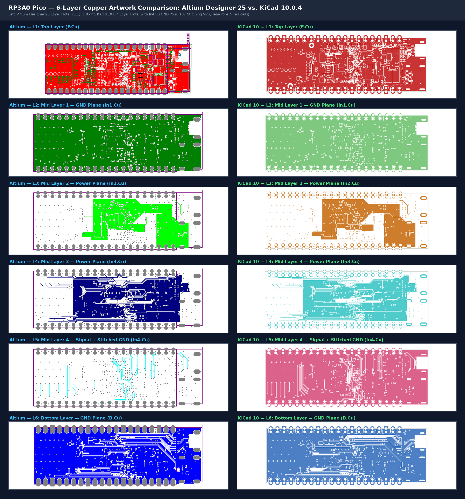

# RP3A0 Pico: 6-Layer Raspberry Pi Zero 2W SiP Carrier in Pi Pico Form Factor


-success)


Native **KiCad 10** hardware translation and JLCPCB 6-layer manufacturing release of the open-source **RP3A0 Pico** (`https://github.com/jonny12375/rp3a0`), integrating the **Raspberry Pi RP3A0-AU System-in-Package** (Quad-core 64-bit ARM Cortex-A53 @ 1 GHz + 512 MiB LPDDR2 SDRAM) into a Raspberry Pi Pico castellated module with Micro-HDMI, USB-C OTG, and microSD storage.


---

## 1. System Architecture

```text
+-----------------------------------------------------------------------------------+
|                                 RP3A0 PICO (6-LAYER)                              |
|                                                                                   |
|  [J3: USB-C 5V/OTG] ---> [Q1: DMG2305UX] ---> 5V_CORE ---> [U3: RT8088AWSC]       |
|         |                                       (I2C)           |                 |
|         +--------------> [U4: PAM2306AYPKE]                     v                 |
|         |                  |            |                  VDD_CORE (0.6-1.35V)   |
|         |                  v            v                       |                 |
|         |             3V3 (1A)      1V8 (1A) ---> [U2: NCP133AMX125]              |
|         |                  |            |              |        |                 |
|         |                  |            |         DDR_1V25      |                 |
|         v                  v            v              v        v                 |
|  [D2: DFLS130L]        +-----------------------------------------------+          |
|         |              |               U1: RP3A0-AU SiP                |          |
|         v              |   4x Cortex-A53 @ 1GHz + 512MiB LPDDR2 BGA    |          |
|  [J2: Micro-HDMI] <----+-- 4x TMDS (FL1-FL4 EXC24CH900U) + CEC/HPD (U5)|          |
|                        |                                               |          |
|  [J1: MicroSD]    <----+-- 4-bit SDIO (SD_CLK, SD_CMD, SD_DAT0..3)     |          |
|  [Y1: 19.2MHz]    <----+-- Primary Crystal Oscillator (27pF C6, C9)    |          |
|  [J5: Pico 40-Pin]<----+-- Castellated GPIO0..GPIO25, 3V3, VBUS, GND   |          |
+-----------------------------------------------------------------------------------+
```

---

## 2. Hardware Specifications

- **SoC / SiP (`U1`):** Broadcom / Raspberry Pi `RP3A0-AU` (323-ball 0.65 mm pitch BGA, 15 × 15 mm; harvested and reballed with 0.3 mm solder balls from a donor Raspberry Pi Zero 2W).
- **Form Factor & Dimensions:** `60.00 mm × 20.35 mm` overall (`51.00 mm × 20.35 mm` standard Raspberry Pi Pico 40-pin castellated footprint + `9.00 mm` right-side overhang for Micro-HDMI and USB-C receptacles).
- **6-Layer JLCPCB Stackup (`1.61 mm` ENIG):**
  - `F.Cu` (1 oz): All 93 SMT components, `U1` BGA fanout, `TP10`–`TP22`/`TP28` Wi-Fi/BT SDIO/UART test pads, 3 global optical fiducials (`FID1`–`FID3`), and local power polygons.
  - `In1.Cu` (0.5 oz): Continuous `GND` reference plane + inner BGA escape routing.
  - `In2.Cu` (0.5 oz): Split power planes (`5V`, `1V8`, `DDR_1V25`, `VDD_CORE`) + high-speed routing.
  - `In3.Cu` (0.5 oz): Split power planes (`3V3`, `HDMI_5V`, `VDD_CORE`) + signal routing.
  - `In4.Cu` (0.5 oz): Stitched `GND` reference plane pour + GPIO, SDIO, and HDMI routing.
  - `B.Cu` (1 oz): Solid `GND` pour, high-speed differential routing, bottom power/JTAG test points (`TP1`–`TP9`, `TP23`–`TP27`), and `J4` USB Host `USB_ID` solder jumper.
- **Power Management:**
  - `U4` (`PAM2306AYPKE`, LCSC `C508236`): Dual 1 A synchronous buck converter generating `3V3` (`L2` = 4.7 µH) and `1V8` (`L3` = 2.2 µH).
  - `U3` (`RT8088AWSC`, LCSC `C5739348`): I2C-programmable 3 A synchronous buck regulator generating `VDD_CORE` (`L1` = 470 nH).
  - `U2` (`NCP133AMX125TCG`, LCSC `C603545`): 500 mA ultra-low-dropout Fixed 1.25 V LDO generating `DDR_1V25` from `1V8` (`VBIAS` = `3V3`).
  - `Q1` (`DMG2305UX-7`, LCSC `C150470`): High-side P-MOSFET switch gating `5V_CORE`.

---

## 3. Altium Designer Reference vs. KiCad 10 Port Enhancements

| Domain | Upstream Altium Reference (`v1.1`) | KiCad 10 Port & JLCPCB Release |
|---|---|---|
| **EDA Format & Libraries** | Binary Altium `.PrjPcb`/`.SchDoc`/`.PcbDoc` | Native KiCad 10 (`.kicad_pro`/`.kicad_sch`/`.kicad_pcb`) with portable `${KIPRJMOD}` libraries |
| **19.2 MHz Crystal (`Y1`) Load** | `18 pF` caps (`C6`, `C9`) yielding `11.5 pF` effective load vs `18 pF` crystal spec | Updated `C6`, `C9` to `27 pF` (`C0G`, LCSC `C1656`) for exact `16.0 pF` effective crystal load |
| **`In4.Cu` Return Plane & Balance** | Bare signal layer (`<5%` copper density), unreferenced `B.Cu` high-speed pairs | Full-board stitched `GND` copper pour on `In4.Cu` + 27 additional `GND` stitching vias (`107` total) |
| **`5V` Input Trunk Routing** | `0.15 mm` narrow `5V` bridge segment between `J3` VBUS and `U4`/`Q1` | Widened `5V` trunk to `0.50 mm` (`3.3x` width increase) + 3 parallel `5V` stitching vias (`1.8 A` capacity) |
| **Fine-Pitch Solder Mask Webs** | `0.00 mm` mask opening overlap across `U3` (`0.40 mm` WLCSP) and `J2` (`0.40 mm` Micro-HDMI) | Explicit pad/footprint solder mask margins yielding `0.15 mm` (`U3`) and `0.202 mm` (`J2`) green LPI webs |
| **SMT Optical Alignment & Teardrops** | No optical fiducials; abrupt pad/via-to-trace transitions | 3 global optical fiducials (`FID1`–`FID3`) with mask/pour clearances + teardrops enabled on all pads/vias |
| **BOM & LCSC Sourcing** | Discontinued/unstocked parts (`RT9081A`, `DMG1024UV`, `0475710001`, generic LED) | Drop-in LCSC-verified equivalents (`NCP133AMX125TCG` `C603545`, `DMN601VK-7` `C145714`, `47309-2651` `C504691`, `KT-0603G` `C12624`) |
| **CPL Centroid & Rotation** | Raw Altium exports without JLCPCB package rotation offsets | Automated CPL exporter with verified JLCPCB orientation corrections across all 93 top-side SMT parts |



---

## 4. Repository Structure

```text
.
├── Makefile                        # Unified root build, lint, test, validate & fab interface
├── README.md                       # System architecture, visual comparisons & project documentation
├── docs/
│   └── images/                     # Altium vs. KiCad 3D, 6-layer copper, and schematic comparison renders
└── pcb/
    ├── Makefile                    # Hardware verification (ERC/DRC/PyTest) & JLCPCB fab targets
    ├── README.md                   # Detailed PCB stackup, BOM & manufacturing guide
    ├── export_manufacturing.py     # Automated JLCPCB Gerber, Drill, BOM, CPL, D356 & PDF exporter
    ├── fp-lib-table                # Project-local footprint library table (${KIPRJMOD})
    ├── sym-lib-table               # Project-local symbol library table (${KIPRJMOD})
    ├── rp3a0-mini.kicad_pro        # KiCad 10 project & JLCPCB 6-layer design rules
    ├── rp3a0-mini.kicad_dru        # Custom DRC rule for J5 castellated edge pads
    ├── rp3a0-mini.kicad_sch        # Root hierarchical schematic sheet
    ├── rp3a-mini-power.kicad_sch   # Power distribution, PMICs, crystal & U1 power/GND banks
    ├── rp3a0-mini-gpio.kicad_sch   # 40-pin Pi Pico castellated header (J5) & GPIO bank
    ├── rp3a0-mini-hdmi.kicad_sch   # Micro-HDMI (J2), TMDS chokes (FL1-FL4) & USB-C OTG (J3)
    ├── rp3a0-mini-wireless-sd.kicad_sch # MicroSD socket (J1) & Wi-Fi/BT breakout test pads
    ├── rp3a0-mini-misc.kicad_sch   # VideoCore/ARM JTAG test pads, status LED & NC balls
    ├── rp3a0-mini.kicad_pcb        # 6-layer routed PCB layout (0 DRC errors, 100% routed)
    ├── jlcpcb/
    │   ├── rp3a0-mini-bom.csv      # Ready-to-upload JLCPCB SMT Bill of Materials (93 parts, 37 lines)
    │   └── rp3a0-mini-cpl.csv      # Ready-to-upload JLCPCB SMT Component Placement List (93 parts)
    ├── libs/
    │   ├── symbols/rp3a0.kicad_sym # Consolidated project symbol library (34 symbols)
    │   └── rp3a0.pretty/           # Consolidated project footprint library (23 footprints)
    └── tests/
        ├── conftest.py             # KiCad 10 S-expression parsers & ERC/DRC pytest fixtures
        └── test_pcb.py             # Automated hardware verification test suite (16/16 passing)
```

---

## 5. Verification & Validation Summary (`copper-pilot validate`)

All 24 stage-gated checks across stages `S0`–`S8` pass (`PASS: 15 pass, 9 warn, 0 fail, 0 error, 0 skipped`):

| Stage | Check IDs | Result | Summary |
|---|---|---|---|
| **S0 Intake** | `intake.tools`, `intake.project`, `intake.intent` | **PASS** | `kicad-cli 10.0.4`, 124 parts, 232 nets, 6 sheets, 6 copper layers |
| **S1 Architecture** | `arch.review` | **WARN (0 P0/P1)** | Power budget, reset supervisor, and `19.2 MHz` crystal load verified |
| **S2 Parts** | `parts.bom_fields`, `parts.lcsc`, `parts.symbols`, `parts.footprints` | **PASS / WARN (0 P0/P1)** | 100% LCSC/MPN/Datasheet coverage across all 93 assembled SMT parts |
| **S3 Schematic** | `sch.erc`, `sch.conventions`, `sch.circuits`, `sch.ratings` | **PASS / WARN (0 P0/P1)** | `0` ERC errors; all regulator feedback dividers and ratings verified |
| **S4 Netlist/Rules** | `pcb.parity`, `pcb.rules` | **PASS** | `0` schematic-to-PCB parity issues, `0` unconnected items, JLCPCB rules clean |
| **S5 Placement** | `pcb.placement` | **PASS** | 100% single-sided Top SMT placement with tight PMIC/BGA decoupling loops |
| **S6 Routing SI/PI** | `pcb.power_routing`, `pcb.signal_integrity` | **WARN (0 P0/P1)** | Continuous `In1.Cu`/`In4.Cu` GND planes, `0.50 mm` `5V` trunk, 107 GND vias |
| **S7 DFM/DFA** | `pcb.drc`, `dfm.fab`, `dfa.assembly`, `pcb.silkscreen` | **PASS / WARN (0 Fail)** | `0` DRC errors, `>=0.15 mm` solder mask webs, 3 global fiducials (`FID1`–`FID3`) |
| **S8 Release** | `release.outputs`, `release.repo`, `release.cpl` | **PASS** | 35 Gerber/drill files, portable `${KIPRJMOD}` tables, verified BOM/CPL exports |

---

## 6. Quickstart & Verification Commands

```bash
# Run full test suite and static analysis (16 PyTest checks + KiCad ERC + KiCad DRC)
make all

# Run KiCad CLI Electrical & Design Rule Checks directly
make erc
make drc

# Run CopperPilot stage-gated validation (S0-S8)
make validate

# Generate complete JLCPCB 6-layer manufacturing release bundle in pcb/build/
make build-pcb
```
