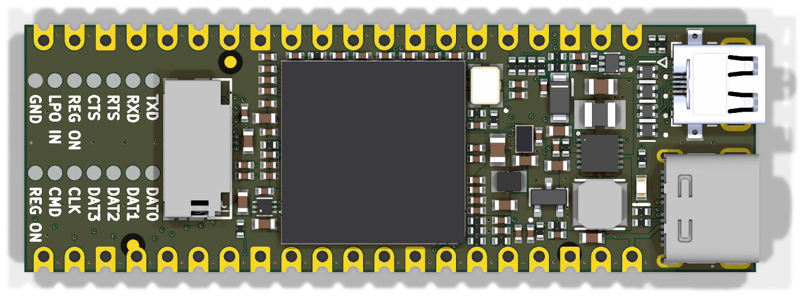
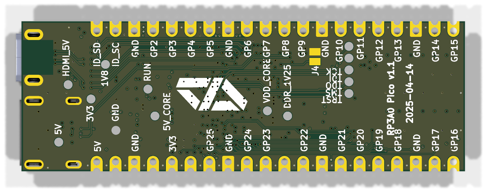
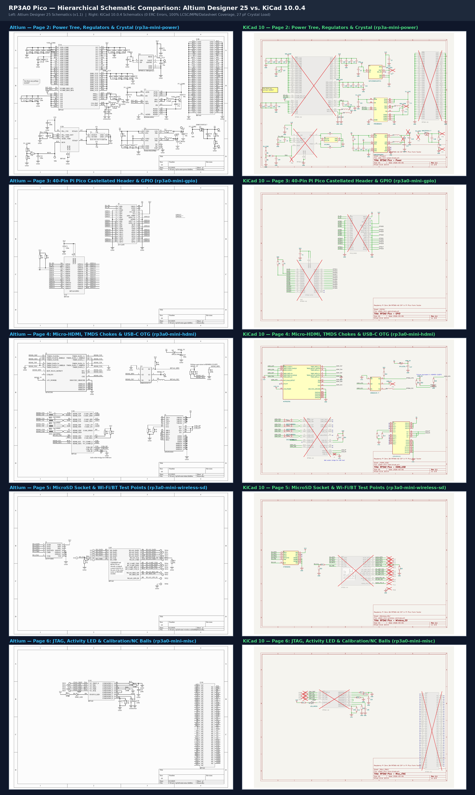

# RP3A0 Pico PCB — KiCad 10 Design & JLCPCB 6-Layer Manufacturing

This directory contains the native **KiCad 10** schematic, 6-layer PCB layout, project-local symbol/footprint libraries, PyTest verification suite, and automated JLCPCB fabrication/assembly export pipeline for the **RP3A0 Pico**.

---

## 1. Board Specifications & Geometry

- **Dimensions:** `60.00 mm × 20.35 mm` (`51.00 mm × 20.35 mm` standard Raspberry Pi Pico castellated body + `9.00 mm` right-hand overhang for Micro-HDMI `J2` and USB-C `J3`).
- **Layer Count & Thickness:** 6 copper layers (`F.Cu`, `In1.Cu`, `In2.Cu`, `In3.Cu`, `In4.Cu`, `B.Cu`), `1.61 mm` nominal thickness, `ENIG` (Electroless Nickel Immersion Gold) surface finish required for 0.65 mm BGA (`U1`) and 0.40 mm WLCSP (`U3`) coplanarity.
- **Fiducials:** 3 non-collinear global optical fiducial targets (`FID1` at `(127.4, 113.0)`, `FID2` at `(135.4, 97.9)`, `FID3` at `(163.2, 113.7)`) with `1.0 mm` copper circles, `2.0 mm` solder mask openings, and `2.1 mm` copper-pour keepouts.
- **Castellations:** 40 plated half-holes (`0.95 mm` drill) on `J5` along top (`y = 94.8286 mm`) and bottom (`y = 115.1786 mm`) board edges.

---

## 2. Fabricator Selection & JLCPCB 6-Layer DFM Rules

| Rule Parameter | Design Minimum | JLCPCB 6-Layer Capability | Status |
|---|---:|---:|---|
| Minimum Track Width | `0.0889 mm` (3.5 mil) | `0.0889 mm` (3.5 mil) | Compliant |
| Minimum Copper Clearance | `0.0889 mm` (3.5 mil) | `0.0889 mm` (3.5 mil) | Compliant |
| Minimum Via Drill / Pad | `0.20 mm` / `0.35 mm` (`0.30 mm` rule) | `0.20 mm` / `0.30 mm` | Compliant |
| Minimum Annular Ring | `0.075 mm` (`0.05 mm` rule) | `0.05 mm` | Compliant |
| Fine-Pitch Solder Mask Web (`U3`, `J2`) | `0.15 mm` (`U3`), `0.202 mm` (`J2`) | `0.10 mm` (Green LPI) | Compliant |
| Minimum Silkscreen Text Height | `0.80 mm` (`0.15 mm` stroke) | `0.80 mm` (`0.15 mm` stroke) | Compliant |

---

## 3. Power Distribution & Thermal Architecture

- **Continuous Ground Return Planes:** `In1.Cu` (0.100 mm below `F.Cu`), `In4.Cu` (0.100 mm above `B.Cu`), and `B.Cu` carry stitched `GND` copper pours tied together by 107 through-hole `GND` stitching vias.
- **Dedicated Internal Power Planes:** `In2.Cu` (`5V`, `1V8`, `DDR_1V25`, `VDD_CORE`) and `In3.Cu` (`3V3`, `HDMI_5V`, `VDD_CORE`) distribute low-impedance power across the board, fed by a `0.50 mm` `5V` input trunk and 3 parallel `5V` stitching vias.
- **Thermal Margin:** All regulators (`U2`, `U3`, `U4`) and pass elements (`Q1`, `D2`) operate with junction temperatures `< 71 °C` at `50 °C` ambient.

---

## 4. Hierarchical Schematic Sheets

| Sheet Name | File | Contents |
|---|---|---|
| `Root` | `rp3a0-mini.kicad_sch` | Top-level hierarchical sheet linking the 5 functional subsheets |
| `Power` | `rp3a-mini-power.kicad_sch` | `U4` (`PAM2306AYPKE`), `U3` (`RT8088AWSC`), `U2` (`NCP133AMX125TCG`), `Q1` (`DMG2305UX-7`), `Y1` (19.2 MHz crystal with `27 pF` load caps `C6`, `C9`), decoupling, and `U1` Power/GND/PLL units |
| `GPIO` | `rp3a0-mini-gpio.kicad_sch` | `U1` GPIO bank (`GPIO0`–`GPIO27`), I2C pull-ups (`R1`, `R2`), and 40-pin Raspberry Pi Pico castellated edge header (`J5`) |
| `HDMI_USB` | `rp3a0-mini-hdmi.kicad_sch` | Micro-HDMI (`J2`), TMDS common-mode chokes (`FL1`–`FL4`), CEC/HPD level shifter (`U5`, `DMN601VK-7`), Schottky diode (`D2`), USB-C (`J3`), and `USB_ID` jumper (`J4`) |
| `Wireless_SD` | `rp3a0-mini-wireless-sd.kicad_sch` | MicroSD card slot (`J1`), `SD_CLK` termination (`R14`, `R15`), and top-side Wi-Fi SDIO / Bluetooth UART test points (`TP10`–`TP22`, `TP28`) |
| `Misc_JTAG` | `rp3a0-mini-misc.kicad_sch` | JTAG test points (`TP23`–`TP27`), activity LED (`D1` `KT-0603G`, `R11`), calibration resistors (`R12`, `R13`, `R16`, `R17`, `R18`), and 86 NC balls |

---

## 5. JLCPCB Fabrication & Assembly Ordering Guide

1. **PCB Specification:** Upload `build/gerbers.zip`, select **6 Layers**, `1.6 mm` thickness, **Green** solder mask, **ENIG** surface finish, **Castellated Holes: Yes (2 edges)**, and **Panel by JLCPCB (with 5 mm tooling rails and routed tabs)** for Standard PCBA.
2. **SMT Assembly:** Upload `jlcpcb/rp3a0-mini-bom.csv` and `jlcpcb/rp3a0-mini-cpl.csv`, select **Top Side Only** (93 SMT parts across 37 BOM lines). Pre-order / Global-Source `U2` (`C603545`), `U3` (`C5739348`), and `J2` (`C6961796`) into your JLCPCB Parts Library prior to assembly checkout; `U1` (`RP3A0-AU`) is marked DNP and hand-reflowed after harvesting/reballing from a donor Raspberry Pi Zero 2W.

---

## 6. Build, Verification & Export Commands (`make`)

- `make all` — Run PyTest verification suite, DRC, and ERC.
- `make test` — Run 16 automated hardware verification tests in `tests/test_pcb.py`.
- `make erc` / `make drc` — Run `kicad-cli` schematic ERC and 6-layer PCB DRC with zone refill and schematic parity.
- `make fab` — Execute `export_manufacturing.py --all` to generate `build/gerbers/`, `build/gerbers.zip`, `build/rp3a0-mini-bom.csv`/`.xlsx`, `build/rp3a0-mini-cpl.csv`/`.xlsx`, `build/rp3a0-mini.d356`, `build/rp3a0-mini_Schematic.pdf`, `build/rp3a0-mini_PCB_Layers.pdf`, `build/ORDER_SPEC.md`, and `build/rp3a0-mini_JLCPCB_Release.zip`.
